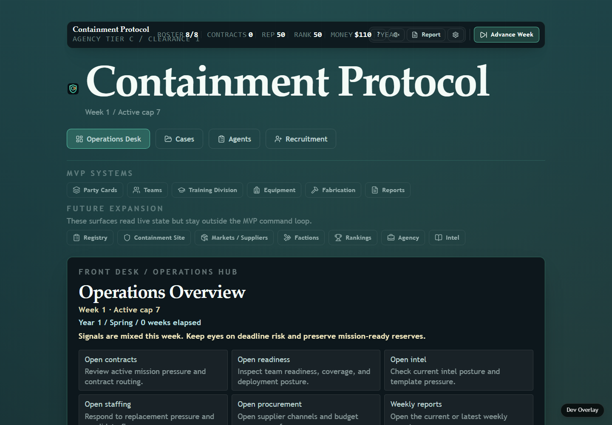
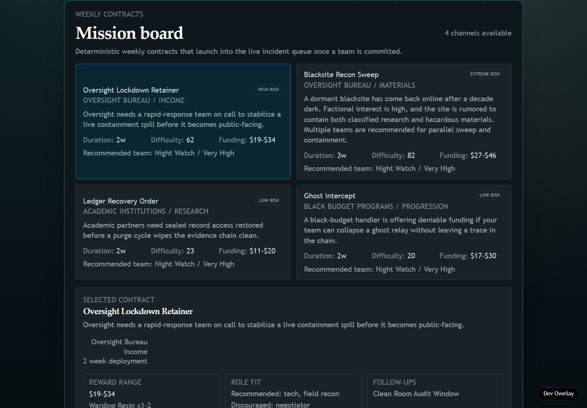
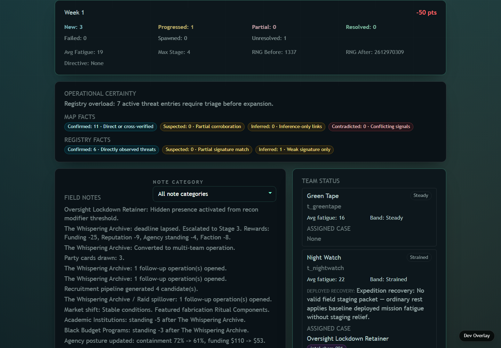

# Containment Protocol

[](https://github.com/JamesJedi420/containment-protocol/actions/workflows/test.yml)

**Run a containment operation where every week is a set of tradeoffs.**

Containment Protocol is a deterministic, browser-based management simulation built with React and TypeScript. Manage incident response, assign squads, plan recruitment and procurement, weigh institutional pressures, and trace outcomes through explicit system handoffs. The focus is on operational decisions and their consequences, not direct tactical combat.

**Explore:** [Project website](https://jamesjedi420.github.io/containment-protocol/) · [Run locally](#quick-start) · [How it's built](#architecture)

**Interested in management sims or deterministic game systems?** [Star the repository](https://github.com/JamesJedi420/containment-protocol) to bookmark it and help other developers discover the project.

> **Development status:** Actively developed work in progress. Individual systems and the hosted experience may be incomplete.

The project is intentionally client-only: no backend, database, external services, or secrets are required to run the app locally.

## Inside the simulation

These screenshots show a local development build captured on November 2, 2026, from commit [`30e3f924`](https://github.com/JamesJedi420/containment-protocol/commit/30e3f92441cf818d832aed819ef8ce4424bce8bb). They illustrate the current work in progress; they do not establish availability of the hosted game. Use [Quick Start](#quick-start) to run the project locally. Open an image to inspect its full-size text.



**Orient your operation.** Start from the Operations Desk and review the current week before choosing your next action.



**Choose a contract and commit a team.** Compare the mission board's risks, duration and funding before launching an operation.



**Review the consequences.** Advancing the week produces a report of incidents, field notes and team status. This example includes early-campaign outcomes.

## Table of Contents

- [Inside the simulation](#inside-the-simulation)
- [Quick Start](#quick-start)
- [Requirements](#requirements)
- [Common Commands](#common-commands)
- [Validation](#validation)
- [Architecture](#architecture)
- [Current Status](#current-status)
- [Project Structure](#project-structure)
- [Contributing](#contributing)
- [Planning and Documentation](#planning-and-documentation)
- [License and Copyright](#license-and-copyright)

## Quick Start

```bash
npm ci
npm run dev
```

Open the Vite dev server at:

```text
http://localhost:5173
```

On Windows PowerShell, `npm.cmd run dev` is also fine.

## Requirements

- Node.js 22
- npm
- A modern browser

No environment variables are required. CI sets `STRICT_TEST_CONSOLE=1` so unexpected console output fails tests.

## Common Commands

| Command                                   | Purpose                                                                                                                                                          |
| ----------------------------------------- | ---------------------------------------------------------------------------------------------------------------------------------------------------------------- |
| `npm run dev`                             | Start the Vite development server with HMR.                                                                                                                      |
| `npm run lint`                            | Run ESLint across the repository.                                                                                                                                |
| `npm run test:run`                        | Run the full Vitest suite once using the local `vmThreads` pool.                                                                                                 |
| `npm run test`                            | Run Vitest in watch mode. Pass a file path to narrow scope while iterating.                                                                                      |
| `npm run test:run:ci`                     | Run the CI test command using the `forks` pool (PR and main).                                                                                                    |
| `npm run coverage`                        | Run tests with coverage output (local `vmThreads` pool).                                                                                                         |
| `npm run coverage:ci`                     | Coverage with the `forks` pool — CI runs this on pushes to `main` only, not on PRs.                                                                              |
| `npm run format`                          | Rewrite files with Prettier.                                                                                                                                     |
| `npm run format:check`                    | Check formatting without editing files.                                                                                                                          |
| `npm run verify:audits-index`             | Verify `docs/design-audits-index.md` matches top-level `docs/*audit*.md` files.                                                                                  |
| `npm run verify:backlog-handoff`          | Verify `planning/backlog.md` handoff matches `planning/backlog-handoff-manifest.json`.                                                                           |
| `npm run verify:theme-contracts`          | Verify SPE mirror coverage against `architecture/external-design-theme-contracts.md`.                                                                            |
| `npm run verify:requirements`             | SPE-3348: resolve and run path-selected required validators (local/CI parity).                                                                                   |
| `npm run verify:requirements:test`        | SPE-3348 selection / unavailable / missing-required unit tests (+ SPE-3304 academy authored-content checks).                                                     |
| `npm run verify:academy-authored-content` | SPE-3304: Academy authored-content validator + fixture suite (`academy/content/**`).                                                                             |
| `npm run session:preflight`               | Evaluate a versioned SPE-3337 evidence envelope from stdin and return `ready`/`blocked`/`unknown`; see [`docs/session-preflight.md`](docs/session-preflight.md). |
| `npm run verify:session-preflight`        | Run the focused read-only preflight test suite.                                                                                                                  |
| `npm run build`                           | Run the TypeScript project build and Vite production bundle. See the note below.                                                                                 |

[SPE-3375](https://linear.app/spectranoir/issue/SPE-3375) recovers the strict TypeScript and Vite production build; [the recovery evidence](docs/typecheck/green-build-2026-11-04/README.md) records zero compiler diagnostics and a literal `npm run build` exit 0. Run that command for current acceptance. It is **not yet a blocking pull-request or release gate**; shared validation-enforcement activation remains separately owned below.

**Build-gate activation policy — single owner: [SPE-3348](https://linear.app/spectranoir/issue/SPE-3348) (shared repository validation orchestration).** Make `npm run build` required and fail-closed for application, build/configuration, and release-related changes **only after** SPE-3375's approved recovery work is complete; `npm run build` exits 0 on a verified current-`main` commit with applicable lint and regression tests green; and SPE-3348's shared validation registry and CI actually enforce the build check. From activation onward, a failed or unavailable required build blocks the affected merge or release; later regressions do not silently make it advisory. SPE-3375 owns build recovery, not validation-enforcement policy. This README rule does not itself enable the CI gate.

Run `npm run verify:trigger-compatibility` to check the Trigger.dev dependency overrides;
see [Trigger.dev development setup](docs/trigger-dev-development.md).

The public game includes minimal browser error reporting to Better Stack; local
development and ordinary automated tests do not send reports by default. See
[error-reporting configuration, privacy limits and verification](docs/better-stack-errors.md).
Run `npm run test:errors` for the isolated, intercepted SDK browser checks.

## Validation

Before opening a pull request, prefer the shared requirement resolver (SPE-3348), which selects the same validators CI will run:

```bash
npm run verify:requirements -- --base origin/main
```

Or run checks that match the scope of your change manually:

```bash
npm run lint
npm run test:run
npm run build:bundle   # application / shared-config / academy + Vite entry
npm run format:check
```

Documentation and planning changes may also need:

```bash
npm run verify:audits-index
npm run verify:backlog-handoff
npm run verify:theme-contracts
```

See `docs/repository-validation-requirements.md`.

GitHub Actions on pull requests runs the requirement resolver: lint, tests, and bundle build for application / shared-config / academy and Vite entry changes, plus the activated audit, theme-contract, governance, and Academy validators. Playwright runs in a separate selected job. Coverage (`npm run coverage:ci`) runs on pushes to `main` / `master` after merge, not on every PR.

## Architecture

The app keeps simulation rules, state orchestration, projections, and UI separate.

| Layer               | Location                                               | Responsibility                                                                              |
| ------------------- | ------------------------------------------------------ | ------------------------------------------------------------------------------------------- |
| Domain              | `src/domain/**`                                        | Deterministic simulation logic, rule evaluators, event contracts, and weekly orchestration. |
| Store and hydration | `src/app/store/**`                                     | Zustand state, save/load compatibility, and run transfer.                                   |
| View models         | `src/features/*View.ts`                                | Pure projections for UI surfaces.                                                           |
| UI                  | `src/features/**`, `src/styles/**`                     | React routes, pages, panels, and presentational components.                                 |
| Starter data        | `src/data/startingState.ts`, `src/domain/templates/**` | Canonical initial state and authorable content templates.                                   |
| Tests               | `src/test/**`, `src/features/**/*.test.tsx`            | Determinism, domain, regression, view-model, UI, and boundary coverage.                     |

Important design rules:

- Simulation output must be deterministic and testable.
- Shared explanatory output should live in canonical domain helpers where possible.
- Optional modules integrate through explicit contracts, not hidden mutable state.
- Type-only imports must use `import type` in Vite-loaded source files.
- Dependency boundaries are enforced by guardrail tests; see `docs/dependency-boundaries.md`.

## Current Status

Recent shipped work includes:

- **Durable affiliation/person-status records** for SPE-1046, including persistence, read-only surfacing, weekly progression, and exact-match mission-routing evidence through existing clearance gates.
- **Publish and contribution operations** for SPE-75, including publish-queue persistence, execution receipts, manual approval, webhook, and modifiable data-pack orchestration.
- **Registry umbrella grooming** for SPE-947 and SPE-1046, with parent issues kept in Backlog until full parent acceptance is satisfied.
- **Mission triage and hidden-state slices** for concealment, intake signal chips, modality tells, and deterministic report notes.

The repository's near-term queue projection is `planning/backlog.md`; authoritative scope, priority, and lifecycle state live in Linear (see SPE-3338). Avoid duplicating long tactical lists in this README.

## Project Structure

```text
.
|-- architecture/            # Long-lived architecture and contract docs
|-- docs/                    # Audits, handoffs, contribution docs, and references
|-- planning/                # Canonical backlog and slice plans
|-- scripts/                 # Repository verification scripts
|-- src/
|   |-- app/                 # App shell, routes, and Zustand store
|   |-- data/                # Copy and starting-state assembly
|   |-- domain/              # Deterministic simulation domain
|   |-- features/            # React feature surfaces and view models
|   |-- styles/              # Shared styling
|   `-- test/                # Domain and integration test coverage
|-- app.vite.config.ts       # Vite app/test configuration
|-- package.json             # Scripts and dependencies
`-- README.md
```

Archived prototype work lives in `docs/archived/incident-shell/` and is not part of the active runtime.

## Contributing

**Linear is the authoritative tracker** for approved scope, issue status, ownership, priority, dependencies, and blockers. GitHub Issues includes **synchronized/mirrored copies of Linear issues** (for example, [GitHub #4268](https://github.com/JamesJedi420/containment-protocol/issues/4268) links back to [SPE-3376](https://linear.app/spectranoir/issue/SPE-3376)); it may also contain GitHub-native automation issues. The roughly 1.8k issues shown in that tab are **not a second independently governed backlog**. Use the corresponding Linear issue for planning and lifecycle changes; do not create duplicate GitHub backlog issues.

Authoritative planning and contribution references:

- Linear team queue: [SpectraNoir SPE](https://linear.app/spectranoir/team/SPE/all)
- PR template: `.github/pull_request_template.md`
- Contribution and release policy: `docs/contribution-and-release-operations.md`
- Agent/session handoff: `AGENTS.md` and `docs/agent-session-handoff.md`

Expected PR flow for an **already-approved implementation slice**:

1. Start from updated `main`.
2. Use the Linear slice issue already approved for the task and set it In Progress when implementation begins.
3. Keep the implementation boundary small and testable.
4. Run targeted checks, then full validation as appropriate.
5. Link the approved Linear issue in the PR body.
6. Merge only after CI is green.

If useful work has no approved issue boundary yet, do **not** create one from this contributing flow. Preserve it as candidate input and route it through the project’s Phase 1 → Phase 2 → Phase 3 (including contradiction review) → Phase 4 candidate-extraction workflow (backlog-shape only; ordinary lifecycle/evidence Linear updates do not use those phases).

After a PR merges, sync local `main` before starting the next approved slice.

## Planning and Documentation

- Near-term queue projection (from Linear): `planning/backlog.md`
- Deferred deep design: `planning/deferred-design-documents.md`
- Documentation curation rhythm: `planning/documentation-curation.md`
- Schema ownership: `SCHEMA_REGISTRY.md`
- Cross-scale handoff contracts: `docs/cross-scale-integration.md`
- Dependency boundaries: `docs/dependency-boundaries.md`

When adding a new top-level `docs/*audit*.md`, update `docs/design-audits-index.md` in strict alphabetical order and run `npm run verify:audits-index`.

## License and Copyright

**All rights reserved.** Containment Protocol is publicly viewable, but its original project material is not released under an open-source license. See [LICENSE](LICENSE) for the rights notice. Third-party components and materials retain their own licenses.
